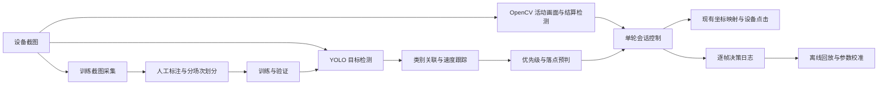

# 百鬼夜行 YOLO 架构与接入

已实现从截图到检测、跟踪、落点预判、受限投豆、日志回放的运行链路，并提供采样节点及工作流样例。模型权重、式神类别和实际界面区域需要用自己的游戏素材配置。仓库没有附带训练完成的百鬼夜行模型，也没有经过实机命中率验证。

## 模块边界



| 层 | 入口 | 职责 |
| --- | --- | --- |
| 模型适配 | `vision/yolo.py` | 延迟加载本地 `.pt/.onnx`、串行推理、ROI、置信度过滤、统一检测结果 |
| 运行时 | `TaskContextImpl.detect_objects` | 项目路径约束、每任务最多缓存两套模型、取消检查 |
| 跟踪 | `vision/hyakki.py:TargetTracker` | 按类别与预测中心做一对一关联、速度估计、短时遮挡保留 |
| 决策 | `ThrowPolicy` | 类别优先级、最少观测帧、全局/单目标冷却、次数上限、目标速度过滤 |
| 动作 | `vision.detect_objects` | 单次检测，返回数组；无目标也是成功，输出 `[]` |
| 动作 | `vision.capture_dataset` | 采样完整画面与元数据，不做自动标注、不执行点击 |
| 动作 | `hyakki.play` | 已进入活动后的有界单轮控制，不自动点开始/结算 |
| 回放 | `tools/hyakki_replay.py` | 复用相同跟踪及决策代码，离线调整参数，不连接设备 |

新动作通过既有 manifest 目录注册；编辑器读取相同参数、默认值和输出结构。`hyakki.play` 标记为有副作用且不可自动安全重试。模型缓存按任务上下文隔离，没有增加独立推理进程或跨实例 GPU 队列；多个实例同时使用 GPU 时要按显存容量配置。

## 坐标与时间

所有公开检测框、跟踪速度和投豆位置使用**工作流参考分辨率**。流程为：参考 ROI → 设备 ROI → 裁剪推理 → 恢复裁剪原点 → 逆缩放至参考坐标 → `context.tap` 映射到设备坐标。禁止把检测框直接当设备坐标再交给 `context.tap`，否则会重复缩放。分辨率发生变化时拒绝推理，需要重新连接设备。

框格式为 `[x1,y1,x2,y2]`，区域参数仍为 `[x,y,width,height]`。`vision.detect_objects` 同时输出 `class_id / label / confidence / box / center / x / y / width / height`，可以通过节点数据引用传给后续节点。

采集开始时间作为保守观测时间。预判公式：

```text
lead = 当前时间 - 采集开始时间 + flight_seconds
x = 框中心 X + vx × lead
y = 框顶部 + 框高度 × aim_y + vy × lead
```

`flight_seconds` 用于校准点击传输和豆子飞行延迟；不是已经测得的游戏常量。首次模型加载较慢时画面会过期，该帧不会投豆。缺失目标只保留关联记录，不向遮挡中的旧位置投豆；预测落点离开投豆区域时直接跳过，不夹到屏幕边缘。该轻量跟踪器对同类目标长时间重叠仍可能发生身份交换，应使用实录评估后再决定是否替换为更复杂的跟踪器。

## 安装与素材

在项目根目录安装可选依赖：

```powershell
.\.venv\Scripts\python.exe -m pip install -r requirements-yolo.txt
```

默认 `device: cpu`；确认 PyTorch 和本机显卡适配后可设为 `"0"`。ONNX 默认使用 CPU runtime；GPU ONNX 需要另外配置对应 runtime。基础应用不在启动时导入 Ultralytics；未安装依赖不影响已有 OpenCV/OCR 节点。安装前检查现有 Paddle/PyTorch/OpenCV 环境兼容性，架构实现没有修改当前已安装的依赖。

运行 `workflows/samples/百鬼夜行_采集.owf`，在真实活动画面采集多场截图。结果位于任务产物目录的 `datasets/hyakki/<session>/`，包括完整 PNG 和 `frames.jsonl`。采样可能持续到结算，结算及空画面可作为负样本。

使用支持 YOLO 检测格式的标注工具，框住可投掷的式神主体。类别可以按具体式神区分，也可以按策略类别区分；`priorities` 必须和模型中的类别名精确一致。不要把 `SSR` 等稀有度当成已有模型自动知道的类别。不同皮肤、朝向、遮挡、特效、缩放和空画面需要在素材中覆盖。

按**完整录制场次**分配训练/验证/测试素材，避免相邻帧同时出现在训练与验证中。数据集目录示例：

```text
datasets/hyakki/
  data.yaml
  images/train/...
  images/val/...
  images/test/...
  labels/train/...
  labels/val/...
  labels/test/...
```

每张图片对应同名 `.txt`，每行 `class_id center_x center_y width height`，坐标按整张图片归一化；负样本可用空标签文件。`data.yaml` 示例，`path` 改为实际绝对路径：

```yaml
path: E:/your-project/datasets/hyakki
train: images/train
val: images/val
test: images/test
names:
  0: target
  1: priority_target
```

## 按式神名标注

活动画面不会显示走路式神的名字（头顶只有状态牌），名字只能来自人工确认的标注。`tools/label_hyakki_names.py` 按"轨迹 + 外观聚簇 + 人工命名"生成多类数据集：

1. 相邻采样帧按 IoU 一对一关联，把框串成行走轨迹（`t####`）；同一只式神的所有框天然同轨。
2. 轨迹按**前景掩码直方图**（帧差掩码 + 2×2 空间网格 HSV 直方图相关，`--cluster-threshold` 默认 0.70）聚簇（`c##`）；簇内多帧平均抑制姿态与背景噪声。宁可多拆簇也不要错并簇。
3. 每簇输出拼图（每条轨迹一行、最多三个时刻，`clusters/<id>__t<轨迹数>__n<格数>[__p分页].jpg`）与 `cluster_names.json` 骨架。

```powershell
# 1) 框提案（运动伪标签 ∪ 检测器提案，IoU 去重）+ 轨迹 + 聚簇
.\.venv\Scripts\python.exe -m src.oooonmyoji.tools.label_hyakki_names propose --device 0
# 1b) 调阈值重聚簇（复用 proposals.json，不重新推理）
.\.venv\Scripts\python.exe -m src.oooonmyoji.tools.label_hyakki_names cluster --cluster-threshold 0.70

# 2) 人工在 datasets/hyakki/name_labeling/cluster_names.json 填名字：
#    纯簇填 clusters[].name；混簇在 track_names 里按轨迹命名 {"t0083": "酒吞童子"}；
#    无法确认的保持 null（apply 跳过）；名字必须是 assets/hero-icons/manifest.json 词表内的式神全名。

# 3) 应用名字，生成 datasets/hyakki/named 多类数据集
.\.venv\Scripts\python.exe -m src.oooonmyoji.tools.label_hyakki_names apply
```

- 框提案合并运动差分框与 `--model` 检测器提案（IoU≥`--merge-iou` 去重，重叠时保留模型框并标记 `motion+model`）；顶部 UI 与玩家立绘区域一律剔除，负样本帧保持空标签。
- 优先级：成员 `overrides`（`{"m0042": "山兔"}` 改名、`{"m0042": ""}` 剔除单框）> `track_names`（空串剔除整条轨迹，用于交叉污染轨迹）> 簇 `name`。拼写错误会被 `apply` 拒绝。
- `apply` 产出 `datasets/hyakki/named/{images,labels}/{train,val}`、类别 id 按出现频次排序的 `dataset.yaml`、`named_report.json`（各类计数、未命名簇、剔除清单、`track_names_applied`）与 `*_named_review.jpg` 中文画框核对图（训练前抽查）。
- 成员/轨迹 id 在 `proposals.json` 中稳定记录框来源、置信度、所属轨迹与簇；拼图用 id 作字幕，因为 OpenCV 无法绘制中文。
- 训练后 `hyakki.play` 的 `priorities` 必须与 `dataset.yaml` 里的名字精确一致。

## 训练、验证与模型交付

将已有的基础检测权重放到本地路径（下方 `base.pt`），再执行官方 CLI。训练、验证和导出是显式操作，不随游戏运行自动触发：

```powershell
.\.venv\Scripts\yolo.exe detect train model=models/hyakki/base.pt data=datasets/hyakki/data.yaml epochs=100 imgsz=640 device=cpu project=artifacts/hyakki-training name=run1
.\.venv\Scripts\yolo.exe detect val model=artifacts/hyakki-training/run1/weights/best.pt data=datasets/hyakki/data.yaml split=test device=cpu
.\.venv\Scripts\yolo.exe export model=artifacts/hyakki-training/run1/weights/best.pt format=onnx imgsz=640
```

训练轮数和尺寸是起步配置，需按素材验证；ONNX 导出可选。将最终 `best.pt` 或导出的 ONNX 及其元数据放到 `models/hyakki/`。运行时只接受项目内已存在的 `.pt/.onnx` 文件，不通过模型名自动下载权重。推理参数和结果字段依据 [Ultralytics Predict 文档](https://docs.ultralytics.com/modes/predict/)，训练、评估和导出分别参见 [Train](https://docs.ultralytics.com/modes/train/)、[Val](https://docs.ultralytics.com/modes/val/)、[Export](https://docs.ultralytics.com/modes/export/)。

## 工作流接入与校准

先使用 `workflows/samples/百鬼夜行_观察.owf`，修改：

1. `resolution`：制作工作流时的参考分辨率。
2. `model`：模型路径。
3. `roi`：实际式神经过、允许投豆的区域。示例的整屏区域只是占位，需要收窄到游戏区域。
4. `priorities`：按优先级排列的模型类别名，例如 `[priority_target, target]`。
5. `active_template`、`end_template`：用自己的截图配置活动进行中和结算标志，避免界面切换后继续投豆。

默认 `dry_run: true`，只计算和记录落点。确认类别、区域和预判方向后，再设为 `false`。`max_throws` 统计点击操作次数；一次点击消耗多少豆、当前剩余豆数都没有由它推断。可在外层流程用现有 OCR 读取豆数并给节点传入预算；节点内部没有专用豆数 OCR 或增益状态逻辑。

外层完整活动流程使用现有工作流节点组合：

```text
OpenCV/OCR 确认活动入口
→ 已有点击节点进入并等待活动进行中标志
→ hyakki.play 执行一轮
→ 根据 reason 判断停止原因
→ OpenCV/OCR 确认结算，点击退出或继续
```

入口和结算按钮的模板、位置需要真实画面，样例没有虚构这些点击坐标。单轮会话遇到结算模板、活动标志消失、无目标超时、最长时长或操作预算耗尽时结束；返回 `reason` 供外层分支处理。无目标超时和时长耗尽只是会话停止，不能视为游戏已结算。

每轮输出产物路径 `trace`，所在目录有 `config.json` 和逐帧 `decisions.jsonl`。日志包含时间、检测框、决策落点及观察标记；不自动保存每帧图片。采样帧可单独用于观察模型效果。

离线回放不需要模型或设备：

```powershell
.\.venv\Scripts\python.exe -m src.oooonmyoji.tools.hyakki_replay artifacts/<run>/hyakki/<session>
.\.venv\Scripts\python.exe -m src.oooonmyoji.tools.hyakki_replay artifacts/<run>/hyakki/<session> --config calibration.json
```

覆盖文件示例：`{"flight_seconds":0.22,"aim_y":0.65,"throw_interval_seconds":0.2}`。回放输出计划投豆次数及落点；它重放已保存的检测结果，不重新推理图片，也不模拟改动点击后游戏世界的变化，不能用来直接计算命中率。实机需要结合画面核对误投、漏投、端到端延迟和真实命中率。

## 验证与当前限制

`tests/test_hyakki.py` 覆盖 ROI 坐标恢复、延迟加载、路径约束、速度预判、优先级、冷却、遮挡、离场、慢推理、投豆上限、取消、界面终止、采集、清单注册、工作流加载和决策回放一致性。测试使用替代检测结果，不下载权重，也不向真实游戏投豆。

当前不包含预训练活动模型、自动标注界面、自动识别所有式神、游戏增益识别、实机测得的投掷物理参数或自动开始下一场。原生模型推理正在执行时取消需等待这一调用返回，返回后会在任何点击前检查取消；采样等待可及时取消。任务上下文缓存的模型随上下文释放，不持有应用级全局模型池。
